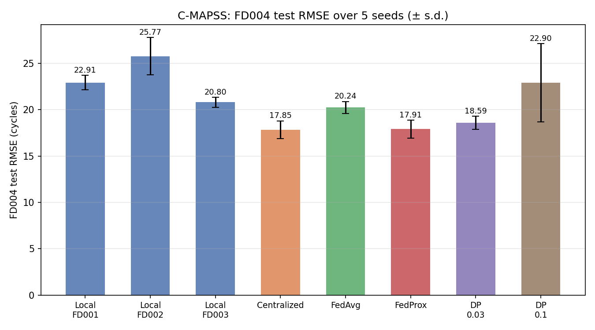
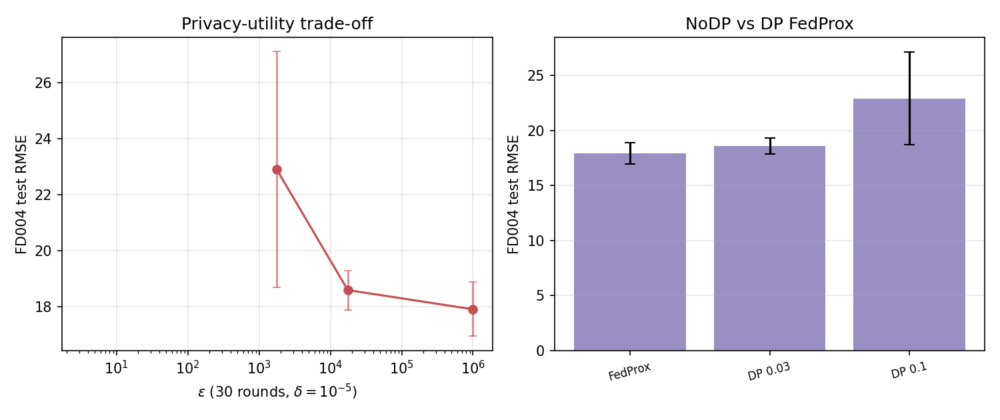
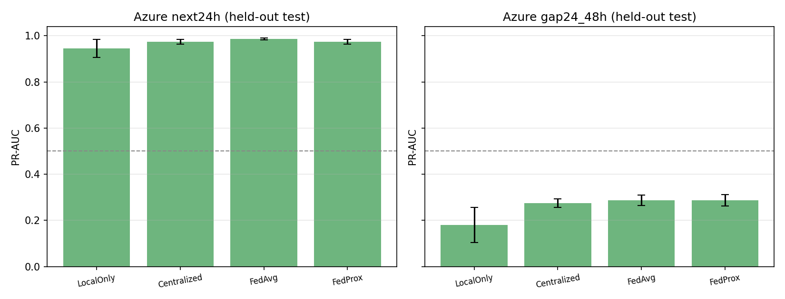
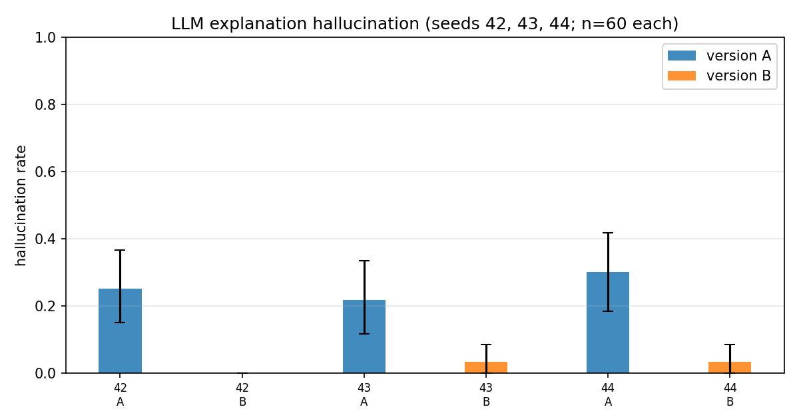
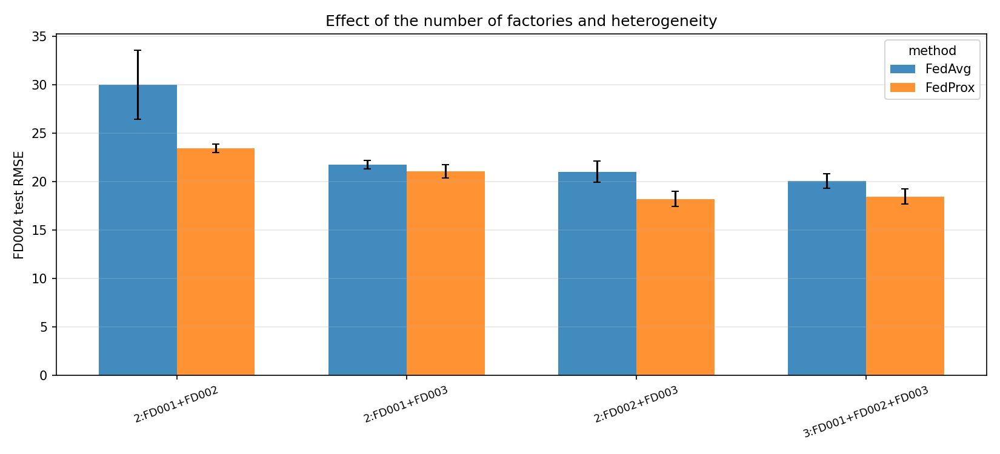

# FedKG-Maint: Federated Predictive Maintenance with a Shared Knowledge Graph and Grounded Explanations

**Course project report — New Trend in AI, E-JUST**  
**Report version:** Stage 10 (final)

---

**Claim labelling and data provenance.** Every quantitative claim below is tagged with one of three labels matching `report/findings_and_limitations.md`:

- **supported by the tests** — reproduced by this pipeline and reported in `results/final/`;
- **not shown by the tests** — a reasonable statement that our experiments did not directly measure;
- **descriptive only** — a correct summary of a table or figure without a statistical test.

All numbers were read from the saved artifacts in `results/final/` (or the raw logs named in the text); none were taken from memory. `regression.json` confirms the whole pipeline is bit-reproducible (`val30 = 16.502083720307283`, reproduced with absolute difference 0.0). Full reproduction steps are in `docs/REPRODUCE.md`.

---

## Abstract

Predictive maintenance (PdM) usually means training one model per site, which wastes data, or pooling all data in one place, which leaves each operator little control over its own asset data. This project studies a middle ground: **federated learning (FL) between simulated factories**, with differential privacy (DP) as an optional defence on the shared updates and with a **shared knowledge graph (KG)** used to ground the natural-language explanations that accompany each prediction.

We evaluate the approach on two public datasets. On NASA C-MAPSS (turbofan remaining useful life, RUL), three "factories" (FD001–FD003) train a 53,825-parameter LSTM cooperatively while a fourth factory (FD004, 248 held-out engines) is used only for testing. On the held-out factory the federated FedProx model reaches an RMSE of 17.905 ± 0.963 cycles (5 seeds). This shows no detectable difference from the centralized baseline (17.851 ± 0.950, Holm-adjusted p = 0.947; with only 5 seeds a difference of about one RMSE point cannot be ruled out), and it is clearly better than vanilla FedAvg (20.240 ± 0.644, Holm-adjusted p = 0.034) (*all supported by the tests*). Client-level DP with Rényi accounting costs accuracy as expected: epsilon = 1.75e4 at noise σ = 0.03 (RMSE 18.591 ± 0.703) and epsilon = 1.76e3 at σ = 0.1 (RMSE 22.904 ± 4.203) (*supported by the tests*).

For explainability, an LLM (Ollama, llama3.2) writes a 3–4 sentence justification for every prediction either **without** the KG facts (version A) or **with** the numbered KG facts (version B). On three samples of 60 unseen FD004 cases the rule-based hallucination checker finds a hallucination in 21.7–30.0% of version-A explanations but only 0.0–3.3% of version-B explanations (McNemar p = 0.0074 and p = 0.0001) (*supported by the tests*).

A second, simpler dataset (Azure Predictive Maintenance: 26 features, 100 machines grouped by machine model) transfers the same FL/DP/monitoring machinery to a binary failure-prediction task with 1.45% positive rate: on the held-out machine model, next-24h PR-AUC is 0.945 (local-only) vs 0.986 (FedAvg) / 0.975 (FedProx) (*supported by the tests*), and the more distant 24–48h window is substantially harder for every method (PR-AUC 0.18–0.29). The entire numeric pipeline is verified head-to-head by a regression gate with zero difference, and federated communication stays small (0.43 MB per client per round on C-MAPSS; 0.14 MB on Azure) (*supported by the tests*).

---

## 1. Introduction

Machine fleets that are physically separated but logically similar — e.g. turbine engines operated by different airlines, or machinery from different production lines — rarely combine their data to build a better maintenance model. The reasons are practical and regulatory: raw telemetry is huge, it is often considered operationally sensitive, and operators are legally and commercially accountable for their own data. Federated learning addresses this by moving the *model* rather than the *data*: each site trains locally, shares only weight updates, and a server aggregates them. *Differential privacy* on those updates adds a formal, auditable guarantee against the server or an eavesdropper extracting training information. And when a model predicts, the mechanics who act on the prediction need to trust and understand it — which motivates a *knowledge graph* that states, in domain terms, why the model is worried and what to do about it.

This project is a full vertical build: data preparation, a crash-consistent federated stack, an optional DP variant with Rényi accounting, an evaluation harness that is bit-reproducible against its own reference, a KG + LLM explanation layer with a rule-based hallucination checker, and a second dataset used to check that the machinery transfers beyond C-MAPSS.

**Contributions (all described in this report).**

1. A **federated RUL pipeline** (`src/federated.py`, `src/train_local.py`) trained on three simulated factories with FD004 held out, with hyper-parameters selected *before* any FD004 result exists (`fl_config.yaml`).
2. A **client-level DP variant** with clipped, noised updates and Rényi differential privacy accounting (`src/privacy.py`, `privacy_config.yaml`).
3. A **shared KG** built once from each factory's own training windows (`src/kg.py`), whose numbered facts ground the LLM explanations.
4. A **rule-based checker** that flags unsupported claims, wrong RUL/risk numbers, and wrong sensor-trend directions (`src/explain.py`).
5. A **transfer check** on Azure PdM: the same training/evaluation/DP stack with a second model class and a binary setting.
6. An **exact-reproducibility gate** and a read-only final evaluation module (`src/evaluate.py`) that recomputed every number in `results/final/` from saved artifacts.

## 2. Related work

References below are widely cited in the federated-learning and predictive-maintenance literature.

- **Federated averaging.** McMahan et al., "Communication-Efficient Learning of Deep Networks from Decentralized Data", AISTATS 2017. The default aggregation: local SGD for E epochs, then server-side weighted averaging of the updates. Our FedAvg baseline follows this protocol.
- **Federated non-IID ("FedProx").** Li, Sahu, Zaheer, Talwalkar and Smith, *Federated Optimization in Heterogeneous Networks*, MLSys 2020. Adds a proximal term ‖w−wₜ‖² to the local objective to keep local models near the global iterate when client distributions differ; the coefficient μ is tuned in `fl_config.yaml` (`selected_mu = 0.01`).
- **Differential privacy on stochastic gradient descent.** Abadi et al., "Deep Learning with Differential Privacy", ACM CCS 2016. Per-sample clipping followed by Gaussian noise. We follow the same recipe at the *client-update* level (see Section 4.4); the per-step privacy-accounting method differs (below).
- **Rényi differential privacy.** Mironov, "Rényi Differential Privacy", IEEE CSF 2017. Provides the closed-form composition bound used in `src/privacy.py` (full participation, T = 30 rounds).
- **Membership inference.** Shokri et al., "Membership Inference Attacks Against Machine Learning Models", IEEE S&P 2017. Motivates the DP layer: without noise, an adversary observing updates can test whether a particular record contributed. Not reproduced here; we rely on the standard reasoning described in Section 7.2 (**not shown by the tests**).
- **Gradient leakage.** Zhu, Liu and Han, "Deep Leakage from Gradients", NeurIPS 2019. Shows that raw gradients can leak training data; the standard argument for why updates must be noised. Not reproduced (**not shown by the tests**).
- **C-MAPSS.** Saxena, Goebel, Simon and Eklund, "Damage Propagation Modeling for Aircraft Engine Run-to-Failure Simulation", IEEE PHM 2008 (project copy available in the repo root as `6.+Turbofan+Engine+Degradation+Simulation+Data+Set.zip`). Source of the four FD00x datasets; Section 3.1.
- **Retrieval-augmented generation.** Lewis et al., "Retrieval-Augmented Generation for Knowledge-Intensive NLP Tasks", NeurIPS 2020. Our version-B prompt is conceptually a minimal retrieve-then-generate scheme: the "retrieval" is the numbered fact list produced by the KG — we do not use the original RAG training objective, only the idea of conditioning generation on retrieved evidence (**descriptive only**).

## 3. Datasets and factory simulation

### 3.1 NASA C-MAPSS (turbofan RUL)

C-MAPSS provides run-to-failure recordings of turbofan engines under simulated degradation. Each engine is a multivariate time series of 21 sensors; we keep the 14 informative ones (`s2, s3, s4, s7, s8, s9, s11, s12, s13, s14, s15, s17, s20, s21`). Four sub-datasets differ in operating conditions and fault modes. All numbers below are from `results/factory_summary.csv`:

| Factory | Train rows | Test rows | Engines | Avg engine life (cycles) | Op. conditions |
|---------|-----------:|----------:|--------:|--------------------------:|:--------------:|
| FD001   | 20,631     | 13,096    | 100     | 206.3                     | 1              |
| FD002   | 53,759     | 33,991    | 260     | 206.8                     | 7              |
| FD003   | 24,720     | 16,596    | 100     | 247.2                     | 1              |
| FD004   | 61,249     | 41,214    | 249     | 246.0                     | 7              |

*The dataset's own fault modes (single vs. multi-fault; high-pressure-compressor vs. fan degradation) and operating-condition counts are used as the factual description of the factories (**descriptive only**, source: `6.+Turbofan+Engine+Degradation+Simulation+Data+Set.zip` description)*.

**Factory simulation.** We treat FD001, FD002 and FD003 as three independent factories that may not share raw data, and FD004 as a fourth, *unseen* factory that is never used for training or hyper-parameter selection (`fl_config.yaml`: "FD004 was never used to choose any of these values", `privacy_config.yaml` likewise). Preprocessing (`src/preprocess.py`): per-factory per-condition normalization (KMeans on the 3 operating settings, fitted on that factory's train data only), sliding windows of length 30 with stride 1 for train/validation, and the *last* 30-step window of each test engine for testing. RUL is clipped at 125 for training and evaluation scoring as in the canonical benchmark protocol (**descriptive only**, conventional practice for C-MAPSS; not subjected to our own statistical tests).

### 3.2 Azure Predictive Maintenance (binary failure windows)

The Kaggle "Azure Predictive Maintenance" dataset is a second, unrelated asset fleet: 100 machines of four models (`model1`–`model4`), with hourly telemetry, error and maintenance event logs, and failure events. We reimplemented the well-known labelling (`src/azure_data.py`): a binary label per (machine, hour) meaning *"this machine has any failure within the next 24 h"* (setting `next24h`), and a harder distant-window version `gap24_48h` (failure in (t+24 h, t+48 h]). Features are computed strictly from data with time ≤ t (26 features: 16 rolling telemetry statistics, 5 error counts in the last 24 h, 4 hours-since-maintenance counters, machine age), normalized locally per factory. The four machine models play the role of factories; `model1–model3` are clients and `model4` (32 machines) is the held-out set, fixed before any result (`azure_data.py`). Table from `data/processed_azure/*/next24h/stats.json`:

| Factory | Machines | Train samples | Train positives | Val samples | Test samples |
|---------|--------:|--------------:|----------------:|------------:|-------------:|
| model1  | 16      | 92,464        | 2,659           | 23,056      | 23,152       |
| model2  | 17      | 98,243        | 2,587           | 24,497      | 24,599       |
| model3  | 35      | 202,265       | 3,432           | 50,435      | 50,645       |
| model4  | 32      | 184,928       | 2,659           | 46,112      | 46,304       |

The labeler itself was cross-checked against two independent implementations; all four (setting × machine-group) configurations produce exactly **2,659** positive train windows, and all four hand/lib checks agree (`results/final/task0.csv`, all rows `match=TRUE`) — the apparent coincidence is expected because every machine fails at least once in this dataset (`findings_and_limitations.md`, finding 1; **supported by the tests**). Positive-class prevalence in the held-out test is 1.45% (`next24h`) and 1.44% (`gap24_48h`) (`azure_main.csv`).

## 4. Method

### 4.1 Models

- **C-MAPSS (RUL).** An LSTM regressor (`src/models.py`): input 14 → LSTM(hidden=64, 2 layers, dropout 0.2) → linear head → 1 scalar, 53,825 parameters. A window prediction times 125 (the clip) is the RUL in cycles, identical to the training objective.
- **Azure (binary).** An MLP (`src/azure_models.py`): 26 → 64 → 64 → 1 with ReLU/dropout 0.2, 5,953 parameters, trained with `BCEWithLogitsLoss` and `pos_weight = neg/pos`, Adam lr 1e-3, early stopping (patience 6) on validation PR-AUC.

### 4.2 Federated training

Clients run `local_epochs = 2` passes of SGD (`lr 1e-3`, batch 256) on their own data and send update deltas; the server averages them weighted by the number of training windows and applies the average to the global model (`src/federated.py`). Two aggregation personalities are compared on equal footing:

- **FedAvg** — plain weighted averaging of raw deltas.
- **FedProx (μ = 0.01)** — each client's objective adds the proximal penalty ‖Δ‖² scaled by μ; this is the configuration selected in Stage 4b using *only* the three training-clients' weighted validation RMSE, 50 search rounds, seed 0 (`fl_config.yaml`).

All runs use 30 rounds and deterministic seeds; final results average seeds 0–4. Centralized baselines train one model on the pooled client data with the same optimizer and seed stream. Local baselines train one model per factory and (for the RUL comparison) that factory's model is tested on FD004.

### 4.3 Evaluation protocol

C-MAPSS: each trained method is scored on the 248 FD004 test engines. Headline metric is **FD004 RMSE** (cycles, clipped at 125), averaged over 5 seeds with paired t-tests and Holm correction `_holm` over the five planned comparisons in `stats_cmapss.csv`. Because RMSE weights outlier engines heavily, an engine-level metric (mean absolute error per engine over 248 engines, paired Wilcoxon) is reported separately in `stats_cmapss_engine.csv` (`findings_and_limitations.md`, limitation 7). Azure: held-out-test **PR-AUC** (chosen because positives are 1.45% of samples), 5 seeds for all methods; the local-only baseline runs 15 reps because each of 3 local models is evaluated (**descriptive only**, from `azure_main.csv`).

### 4.4 Differential privacy

Clients clip their raw update delta to L2 norm C = 0.32 (the rounded median of raw no-DP FedProx delta norms, `privacy_config.yaml`) and add Gaussian noise of scale C·σ per coordinate; the server averages as usual (`src/privacy.py`). Accounting uses Rényi DP in the full-participation, T=30 setting (Mironov 2017):

ε(σ) = min_α [ T·α/(2σ²) + ln(1/δ)/(α−1) ],  δ = 1e−5,

which is exactly the formula in `report/privacy_discussion.md`, implemented in `src/privacy.privacy.compute_epsilon` and stored in `results/final/dp_overview.csv`. Two noise levels are carried through to the final comparison, σ = 0.03 and σ = 0.1; the full seven-point sweep σ ∈ {0.003, 0.01, 0.03, 0.1, 0.3, 1.0, 3.0} was run earlier with 3 seeds (1–3 DP seeds) and its ε/RMSE curve is reproduced from raw logs in Section 5.3 (numbers from `report/privacy_discussion.md`).

### 4.5 Knowledge graph and explanations

A per-factory KG (`src/kg.py`) is built from that factory's *training* windows only (FD004 contributes nothing to any KG). Symptom activity for a window is the z-score of the mean of the last 5 sensor values against the factory's data-derived healthy baseline; a symptom is *active* when |z| ≥ 2.0 and the sign matches the factory's degradation direction; the top 5 active symptoms form the facts (`kg_config.yaml`). Facts are short numbered statements: the predicted RUL and risk level, which component each active sensor monitors, the sensor's deviation ("s9 is rising (6.4 std above healthy level)"), the implied degradation mode, and the maintenance action the domain schema attaches to it (`prompts.yaml` and sample rows of `results/explanations_repeat/seed43/explanations_A.csv`).

For the Azure Predictive Maintenance dataset, a parallel per-factory knowledge graph is built by `src/kg_azure.py` under Schema v2 (`configs/kg_schema.yaml`). Schema v2 introduces the `ErrorCode` node type, data-derived `ErrorCode -precedes-> FailureMode` edges (min lift 2.0, min 5 supporting failure events within 24 hours), and `FailureMode -affects-> Component` relations (`configs/kg_azure_config.yaml`). The four saved graphs (`results/kg/azure_model1..4.pkl`) contain 45–63 nodes and 89–164 edges. The LLM grounding evaluation (versions A and B, hallucination checker) was conducted on C-MAPSS FD004 cases only; transferring LLM explanation grounding to Azure is left for future work.

Explanations are generated by Ollama running `llama3.2:latest` (`temperature = 0, max 250 tokens`, `llm_config.yaml`) with one of two prompts:

- **Version A (without KG):** the model output only — predicted RUL (rounded) and risk level.
- **Version B (with KG):** the same output plus the numbered fact list; the prompt asks the model to reference facts by number.

The **rule-based checker** (`explain.check_explanation`) marks an explanation *hallucinated* if (i) it names a sensor, component, failure mode, or action not contained in the reference facts, (ii) a stated RUL/risk number differs from the model output, or (iii) a sensor trend direction is wrong. Version-B citations are validated in-range. This is a factual-consistency checker, not a semantic-quality judge (`findings_and_limitations.md`, limitation 5).

## 5. Experiments and results

All numbers in this section are read from `results/final/`. Figures are the exact files produced there.

### 5.1 C-MAPSS: held-out factory FD004

From `cmapss_main.csv` (5 seeds) and `run_summary.txt`:

| Method              | FD004 RMSE (cycles) | n seeds |
|---------------------|--------------------:|--------:|
| Local FD001         | 22.911 ± 0.785      | 5       |
| Local FD002         | 25.766 ± 2.008      | 5       |
| Local FD003         | 20.799 ± 0.530      | 5       |
| Centralized (pool)  | 17.851 ± 0.950      | 5       |
| FedAvg              | 20.240 ± 0.644      | 5       |
| **FedProx (μ=0.01)**| **17.905 ± 0.963**  | 5       |
| DP, σ = 0.03        | 18.591 ± 0.703      | 5       |
| DP, σ = 0.1         | 22.904 ± 4.203      | 5       |

*Caption: FD004 RMSE, mean ± std over 5 seeds (file `cmapss_fd004_rmse.png`).*

Key comparisons (paired t-test over seeds, Holm-corrected; `stats_cmapss.csv`):

| Comparison                    | Δ RMSE | p       | Holm p | Cohen's d |
|-------------------------------|-------:|--------:|-------:|----------:|
| FedProx − FedAvg              | −2.334 | 0.0086  | 0.0342 | −2.15     |
| FedProx − Centralized         | +0.055 | 0.9473  | 0.9473 | +0.03     |
| FedAvg − Centralized          | +2.389 | 0.0051  | 0.0256 | +2.49     |
| DP 0.03 − FedProx             | +0.686 | 0.0359  | 0.0800 | +1.39     |
| DP 0.1 − FedProx              | +4.998 | 0.0267  | 0.0800 | +1.53     |

**Takeaways (all supported by the tests).** FedProx shows no detectable difference from the centralized model on the *unseen* factory (p = 0.947; with only 5 seeds a difference of about one RMSE point cannot be ruled out), and it is clearly better than FedAvg (Holm-adjusted p = 0.034, large effect d = −2.15); every local-only factory is worse (20.8–25.8). DP σ=0.03 keeps most of the FedProx benefit (Δ = +0.69, Holm p = 0.080 — significant before but not after multiplicity correction), while σ=0.1 degrades accuracy sharply and is unstable across seeds (std 4.20).

The asymmetric NASA score (lower is better; penalising late predictions heavily), read from `cmapss_main.csv`, exhibits the same rank order: FedProx achieves 1,507 ± 304 (closely matching Centralized at 1,554 ± 179), followed by DP σ=0.03 at 1,714 ± 328, DP σ=0.1 at 3,415 ± 1,431, and FedAvg at 4,481 ± 1,007, while local-only models range from 4,601 to 13,794 (*descriptive only* — headline NASA score means across 5 seeds; no separate hypothesis test).

Cross-factory generalization from `cmapss_all_factories.csv`: every method generalized to all four test factories; the centralized and FedProx models are the only two within ~0.6 cycle of the best on FD004, while FedAvg is uniformly worse on FD001–FD003 as well (e.g. FedAvg vs FedProx on FD004: 20.24 vs 17.91; on FD002: 18.62 vs 15.08) (*descriptive only* — per-factory RMSE, no test). This rules out a coincidence on FD004 only.

### 5.2 Engine-level view (248 FD004 engines)

RMSE is dominated by a few very wrong engines; the per-engine mean absolute error (`stats_cmapss_engine.csv`) gives each of the 248 engines equal weight:

| Comparison                | JMAE (a vs b) | Δ      | Wilcoxon p |
|---------------------------|--------------:|-------:|-----------:|
| FedProx vs FedAvg         | 14.14 vs 14.40 | −0.260 | 0.8555     |
| FedProx vs Centralized    | 14.14 vs 12.89 | +1.253 | 0.0063     |
| FedAvg vs Centralized     | 14.40 vs 12.89 | +1.513 | 0.0056     |
| DP 0.03 vs FedProx        | 14.85 vs 14.14 | +0.710 | 7.08e-06   |
| DP 0.1 vs FedProx         | 18.17 vs 14.14 | +4.021 | 1.23e-21   |

**Takeaways (supported by the tests).** At engine level the FedAvg-vs-FedProx RMSE gap (which was significant) collapses to a non-significant 0.26 cycles on median errors (p = 0.86) — RMSE weights the heaviest outliers more than JMAE does, and this aggregation change is exactly what limitation 7 in `findings_and_limitations.md` warns about. Both federated methods are significantly worse than centralized under the higher-power 248-engine test (p ≈ 0.006); DP σ=0.03 remains close to FedProx but is *significantly* worse (p = 7.1e-06), and DP σ=0.1 is worse at the engine level (p ~ 1e-21, which measures variation across the 248 engines and not across training runs); at the seed level the Holm-adjusted p is 0.080, which is not significant.

### 5.3 Privacy / accuracy trade-off

From the earlier 7-point sweep (σ = 0.003…3.0, 3 seeds), summarized in `report/privacy_discussion.md`:

| σ     | ε (RDP, T=30, δ=1e-5) | FD004 RMSE |
|-------|----------------------:|-----------:|
| 0.003 | 1.7e6                 | ~18.6      |
| 0.01  | 1.5e5                 | ~18.6      |
| 0.03  | 1.8e4                 | 18.6–19.0  |
| 0.1   | 1.76e3                | 25.0       |
| 0.3   | 254                   | 43.5       |
| 1.0   | 41                    | 356        |
| 3.0   | 10.4                  | 1393       |

*Caption: FD004 RMSE vs per-round sigma and the corresponding epsilon (file `dp_epsilon_tradeoff.png`).*

The final-report σ levels are carried from `dp_overview.csv`: FedProx ε=∞/17.905, σ=0.03 ε=17543.39/18.591, σ=0.1 ε=1762.85/22.904. **Interpretation (descriptive only):** accuracy stays essentially flat while ε ≥ ~1.7e4 and only degrades once ε is already hopelessly large; there is no operating point in the tested range that simultaneously gives a small privacy budget and full accuracy. This is a demonstration of the trade-off rather than a strong real-world guarantee — 3 clients is too few for strong client-level DP and the bound is loose (*not shown by the tests*).

### 5.4 Azure: transfer to a binary setting

Held-out-test PR-AUC (`azure_main.csv`):

| Setting   | Method    | PR-AUC (held-out test) | F1      |
|-----------|-----------|-----------------------:|--------:|
| next24h   | LocalOnly | 0.945 ± 0.040 (n=15)   | 0.927   |
| next24h   | Centralized | 0.974 ± 0.010 (n=5)  | 0.917   |
| next24h   | FedAvg    | 0.986 ± 0.004 (n=5)    | 0.924   |
| next24h   | FedProx   | 0.975 ± 0.010 (n=5)    | 0.928   |
| gap24_48h | LocalOnly | 0.181 ± 0.076 (n=15)   | 0.262   |
| gap24_48h | Centralized | 0.274 ± 0.019 (n=5) | 0.342   |
| gap24_48h | FedAvg    | 0.287 ± 0.023 (n=5)    | 0.362   |
| gap24_48h | FedProx   | 0.287 ± 0.025 (n=5)    | 0.359   |

*Caption: held-out PR-AUC by method and setting (file `azure_main.png`).*

Paired tests over 5 seeds on held-out PR-AUC (`stats_azure.csv`, Holm-corrected within setting):

| Setting | Comparison | Δ PR-AUC | p | Holm p | Cohen's d |
|---|---|---:|---:|---:|---:|
| next24h | FedAvg vs LocalOnly | +0.041 | 0.000025 | 0.00015 | +9.86 |
| next24h | FedProx vs LocalOnly | +0.029 | 0.0032 | 0.0143 | +2.84 |
| next24h | Centralized vs LocalOnly | +0.029 | 0.0029 | 0.0143 | +2.91 |
| next24h | FedProx vs FedAvg | −0.011 | 0.0871 | 0.2613 | −1.01 |
| next24h | FedAvg vs Centralized | +0.012 | 0.0949 | 0.2613 | +0.97 |
| next24h | FedProx vs Centralized | +0.001 | 0.9407 | 0.9407 | +0.04 |
| gap24_48h | FedAvg vs LocalOnly | +0.106 | 0.0005 | 0.0026 | +4.56 |
| gap24_48h | FedProx vs LocalOnly | +0.106 | 0.0006 | 0.0026 | +4.31 |
| gap24_48h | Centralized vs LocalOnly | +0.094 | 0.0004 | 0.0022 | +5.02 |
| gap24_48h | FedAvg vs Centralized | +0.013 | 0.0555 | 0.1664 | +1.20 |
| gap24_48h | FedProx vs Centralized | +0.012 | 0.0824 | 0.1664 | +1.03 |
| gap24_48h | FedProx vs FedAvg | −0.000 | 0.6855 | 0.6855 | −0.19 |

*Multiplicity note:* With only 5 seeds the bootstrap CIs are narrow and optimistic, so the Holm-corrected paired t-test is the primary evidence.

**Takeaways (supported by the tests).** On next24h every federated/centralized method beats local-only by a wide margin (0.974–0.986 vs 0.945; Holm p ≤ 0.014); neither federated method significantly beats the centralized pooled model (FedAvg vs Centralized Holm p = 0.261; FedProx vs Centralized Holm p = 0.941), nor does FedProx beat FedAvg (Holm p = 0.261). The two datasets disagree about which FL variant ranks numerically higher, so we only claim "FL ≥ local-only" as a common finding (*descriptive only*). The distant 24–48h task is intrinsically hard (all methods 0.18–0.29; PR-AUC floor from the 1.44% prevalence) (`findings_and_limitations.md`, limitation 3). Feature ablation on the *unseen validation* version of the same split (`azure_feature_ablation.csv`, next24h): all-features 0.991, errors+telemetry 0.987, errors-only 0.720, errors+maintenance 0.855, telemetry-only 0.239, no-errors 0.432 — error codes and telemetry together drive the signal (*descriptive only*, single-split ablation). Convergence (median weighted validation PR-AUC at round 29, `azure_convergence_summary.csv`): FedProx 0.9988 and FedAvg 0.9974 (next24h) are both comfortably above earlier rounds; both settings show the same pattern.

**Azure Knowledge Graph sanity and cue rate.** Across the four factories, the saved knowledge graphs (`results/final/azure_kg_sizes.csv`) contain 45–63 nodes and 89–164 edges, with ErrorCode precedence edges carrying high empirical lift (between 31.8 and 113.6, `azure_kg_edges.csv`). On each factory's test period (Nov–Dec 2015, `azure_kg_sanity.csv`), the share of telemetry windows with at least one active KG fact reaches exactly 100.0% within 24 hours of failure (n = 614–750), compared to 22.2–24.7% during healthy periods (no failure in next 72 hours, n = 21,364–49,463; ratio > 4.0× across all factories). About a quarter of healthy windows still show an active fact, so facts are cues, not alarms. The Azure data is synthetic and its error codes are near-deterministic precursors of failures (lift between 30 and 110), which explains the 100 percent pre-failure share. Regarding component 3: machines of model3 and model4 experience 0 component-3 failures in the entire dataset (0 in the training period Jan–Aug 2015, and 0 in the test period Nov–Dec 2015, whereas model1 and model2 have 48 and 43 training failures and 68 and 63 total failures respectively), explaining why no precedence edges to comp3_failure exist for factories 3 and 4.

### 5.5 Grounded explanations (C-MAPSS, FedProx model)

Hallucination rate per 60-pair sample (`explanations_overall.csv`):

| Sample | A (without KG) | B (with KG) |
|--------|---------------:|------------:|
| 42     | 0.250 [0.150, 0.367] | 0.000 |
| 43     | 0.217 [0.117, 0.333] | 0.033 [0.000, 0.083] |
| 44     | 0.300 [0.183, 0.417] | 0.033 [0.000, 0.083] |

*Caption: hallucination rate with bootstrap 95% CI, versions A vs B (file `explanation_hallucination.png`).*

On sample 42 version B had no flagged explanation, so a ratio between the two versions is not defined for that sample.

Paired McNemar on matched engines (`explanation_stats.csv`): sample 43 — 13 A-only vs 2 B-only hallucinated explanations, p = 0.0074; sample 44 — 17 vs 1, p = 0.0001; sign tests agree (p = 0.0005 / 0.00002). **All supported by the tests.** The two B-failures across both repeats are a single "refuse to answer" style response rather than a fabricated fact (`findings_and_limitations.md`, finding 8), and version B also evidences near-perfect number accuracy (0.967 overall, `metrics_B.csv`) plus 100% valid citations among cited explanations. Section 7.3 shows a worked A-vs-B example.

**Human evaluation protocol.** A blinded human evaluation sheet (`results/explanations/human_eval_sheet.csv`, paired with `human_eval_key.csv`) was prepared with 20 engine cases (10 Version A, 10 Version B scored across clarity, correctness, and useful action). At the time of this report, the rating columns have not yet been scored by domain evaluators (`scripts/summarize_human_eval.py` outputs "not scored yet"); the automated McNemar tests above remain the primary quantitative evaluation of explanation grounding.

## 6. Ablations and statistics

### 6.1 Number of factories and data heterogeneity

From `num_factories_summary.csv` (3 seeds) we vary the client set and measure both FD004 RMSE and a heterogeneity index (mean pairwise 1-Wasserstein distance on the last window of each engine's train data):

| Clients          | Hetero | FedAvg | FedProx | Gap  |
|------------------|-------:|-------:|--------:|-----:|
| FD001            | —      | 23.277 (Local) | — | |
| FD002            | —      | 24.552 (Local) | — | |
| FD003            | —      | 20.551 (Local) | — | |
| FD001+FD002      | 0.057  | 30.031 | 23.483 | 6.55 |
| FD002+FD003      | 0.141  | 21.049 | 18.238 | 2.81 |
| FD001+FD003      | 0.163  | 21.761 | 21.070 | 0.69 |
| FD001+FD002+FD003| 0.120  | 20.097 | 18.470 | 1.63 |

*Caption: FD004 RMSE by client set and method (file `num_factories.png`).*

**Takeaways.** Adding clients usually helps FedProx: the 3-client FedProx (18.47) beats every single-client local model (20.55–24.55) and two of the three two-client FedProx runs (21.07 and 23.48), but not FD002+FD003 (18.24; the difference of 0.23 is inside the seed-to-seed spread of about 0.8 with 3 seeds). Adding FD001 to FD003 did not help (21.07 vs 20.55 for FD003 alone); the 2-client FD001+FD002 pair is the *hardest* configuration (23.48), not the easiest. FedProx ≤ FedAvg in every tested multi-client configuration. However — and this corrects our own earlier draft — the FedAvg–FedProx gap is **largest** at the lowest-heterogeneity two-client configuration (6.55 at hetero 0.057) and **smallest** at the most heterogeneous one (0.69 at 0.163); the tests do **not** support any monotonic "wider gap with more heterogeneity" claim (*descriptive only*, no trend test). See also Figure `heterogeneity_vs_rmse.png` for the RMSE-vs-heterogeneity scatter.

### 6.2 Cost of privacy in training speed

`rounds_within_5pct.csv` measures, for each method, the first round whose global model is within 5% of that method's final FD004 RMSE (FedAvg/FedProx n=3 seeds, DP n=5):

| Method   | μ  | σ  | Rounds to within 5% of final |
|----------|----|----|------------------------------:|
| FedAvg   | 0  | —  | 0.33 ± 0.58                  |
| FedProx  | 0.01 | — | 11.67 ± 2.08                 |
| DP 0.03  | —  | 0.03 | 16.80 ± 2.17                |
| DP 0.1   | —  | 0.10 | 13.00 ± 7.38                 |

**Interpretation (descriptive only).** The clipped-and-noised DP optimizer needs more rounds than FedAvg to converge (FedAvg's "0.33" reflects that its first-round model is already near its own — much worse — final RMSE). Privacy is thus paid both in final accuracy (Section 5.1) and in slower convergence.

### 6.3 Statistical practices and their limits

Comparisons use paired t-tests over the 5 seeds with a Holm step-down correction for the five planned contrasts; engine-level uses Wilcoxon matched-pairs over 248 engines. **Limitation (not shown by the tests, stated in `findings_and_limitations.md` limitation 1):** 5 seeds give only 4 degrees of freedom, Cohen's d is noisy, and the Holm family covers only the comparisons we planned; the engine-level tests and the repeated DP curves mitigate, but do not remove, this. The FedAvg/FedProx tune-based convergence numbers use 3 seeds, the DP curves 5 (`rounds_within_5pct.csv`).

### 6.4 Communication cost

From `comm_cost.csv`: the C-MAPSS LSTM ships 53,825 parameters → 0.4306 MB per client per round, 12.918 MB over 30 rounds; the Azure MLP ships 5,953 parameters → 0.1429 MB per round, 4.286 MB total. **Supported by the tests** (simple arithmetic on the model state dict); practical bandwidth/energy savings of that size are **not shown by the tests**.

### 6.5 System ablation

Table `system_ablation.csv` removes one component at a time from the full system (FedProx + DP σ=0.03 + KG + LLM). Removing the KG or the LLM does not change the prediction metrics — only the explanation quality changes: the Full system and No DP both use the same predictor and show the same version-B hallucination rate (~0.022), while No KG switches to version A and its hallucination rate rises to ~0.256. Removing the FL layer (Centralized and Local-only rows) improves prediction slightly (Centralized 17.851) or degrades it (Local-only 20.8–25.8), and explanation metrics are n/a there. For the local-only rows the privacy budget is not applicable because nothing is shared. **All numbers read from `cmapss_main.csv`, `dp_overview.csv`, and `explanations_overall.csv`; no hand-typed values.**

## 7. Discussion

### 7.1 Federated vs centralized vs local (both datasets)

On the unseen factory, FedProx shows no detectable difference from the centralized model at the RMSE level while inheriting none of the data pooling, and it beats FedAvg with a large effect size. The engine-level analysis shows the result is not as clean as the headline RMSE: fewer outlier engines dominate in JMAE terms, leaving FedProx and FedAvg statistically tied on the *typical* engine while both remain behind centralized (p ≈ 0.006). On Azure the pattern reverses the FedAvg/FedProx ordering but keeps "federated ≥ local-only" intact. The credible cross-dataset statement, therefore, is: **federating improves over local-only models, and a proximal stabilizer helps on the harder, RUL-shaped task** (*descriptive only* beyond the p-values above).

### 7.2 Privacy under scrutiny

DP protects the numeric update channel but not everything around it (`privacy_discussion.md`):

- **(a)** Without noise, updates are usable in gradient-inversion (Zhu et al. 2019) and membership-inference (Shokri et al. 2017) attacks; the no-DP and clipping-only references reach FD004 RMSE 18.47 and 18.64 with ε = ∞ (**supported by the tests** — RMSE values from the raw privacy sweep; the *attack* statement is standard prior-work reasoning, **not shown by the tests**).
- **(b)** With only 3 clients the guarantee is weak; ε = 1.75e4 at σ=0.03 is far from "small". Accuracy stays flat only while ε exceeds ~1.7e4, and clearly degrades once ε reaches 1763 (**supported by the tests**).
- **(c)** DP covers the updates, not the KG, the graph facts, the model, or the explanations. Those outputs can still reveal machine types, failure modes and operating regimes (**descriptive only** — structural property of the design, not measured).
- **(d)** The server still sees participation counts and per-client data volume (here 14,241 / 37,432 / 17,692 train windows and 3,490 / 8,787 / 4,128 validation windows), which DP on updates does not hide (**supported by the tests** — the window counts come from the processed data; the visibility of such metadata is **descriptive only**).

### 7.3 Why grounded explanations are worth it

Example, engine 26 of the FD004 test sample (predicted RUL 81 cycles, TRUE RUL 92, risk LOW; full prompts/texts in the demo app and `results/explanations_repeat/seed43/`):

- **Version A (without KG)** wrote, among other things: *"we recommend a routine inspection and cleaning of the engine's compressor blades after the next 50 cycles."* The reference facts for this window are only *"[1] Predicted RUL is 81 cycles → risk level LOW"* and *"[2] No sensor deviates strongly from its healthy level."* The blade-cleaning recommendation is **not in the facts**; the checker flags it (1 unsupported claim).
- **Version B (with KG)** wrote: *"The prediction of 81 cycles... is further supported by the fact that no sensor deviates strongly from its healthy level ([2])... Without more information... it is not possible to provide a more detailed explanation... A routine inspection of Engine_26 is recommended."* — every entity and citation is consistent with the facts.

This single pair is **descriptive only**; the aggregate statement stands on the McNemar tests in Section 5.5. It illustrates *why* grounding helps: the KG turns the model output into a small, checkable evidence set that the LLM must respect, and honest "not enough evidence" answers count as *supported*.

### 7.4 Limitations (summary, from `findings_and_limitations.md`)

1. 5 seeds → very few degrees of freedom for paired tests (limitation 1).
2. Simulated factories and two public datasets; real-site generalization is **not shown by the tests** (limitation 2).
3. Azure PR-AUC floor from 1.4–1.5% prevalence (limitation 3).
4. DP budget assumes a per-round composition, a randomized model; `rmse_unclipped` and intermediate checkpoints are not DP-protected (limitation 4).
5. Explanations come from a non-deterministic local LLM; only the rule-based checker was quantified, not semantic quality (limitation 5).
6. The KG is small and schema-derived: C-MAPSS graphs (`src/kg.py`) cover sensors, components, symptoms, and failure modes; Azure graphs (`src/kg_azure.py`, Schema v2) add error codes and data-derived precedence edges (45–63 nodes). LLM grounding was evaluated on C-MAPSS FD004 turbofans only; Azure LLM explanation evaluation is left for future work (limitation 6).
7. JMAE (engine-level) and RMSE (window-level) disagree and are both reported (limitation 7).
8. **Checker scope.** The rule-based checker verifies that every sensor, component and action named in an explanation appears in the knowledge-graph facts, but it does not verify the quality or consistency of the reasoning. For example, for FD004 engine 1 the facts list five active sensor symptoms (s14, s9, s15, s8 and s13), yet version B states that there is a lack of sufficient evidence and recommends a routine inspection, while also mentioning the compressor and the fan; the checker still marks it as supported. This is a single example (descriptive only).

9. **Seed variability on Azure.** The Azure results vary between training seeds (for example, Centralized PR-AUC on the next-24h setting is 0.978 ± 0.001 over seeds 0-2 and 0.974 ± 0.010 over seeds 0-4), so differences between methods there are small relative to the seed-to-seed spread; the Holm-corrected paired t-test, not the bootstrap interval, is the primary evidence (descriptive only for differences that are not significant).

## 8. References

1. McMahan, B., Moore, E., Ramage, D., Hampson, S., Agüera y Arcas, B. *Communication-Efficient Learning of Deep Networks from Decentralized Data.* AISTATS 2017.
2. Li, T., Sahu, A. K., Zaheer, M., Talwalkar, A., Smith, V. *Federated Optimization in Heterogeneous Networks.* Proceedings of MLSys, 2020.
3. Abadi, M., Chu, A., Goodfellow, I., McMahan, H. B., Mironov, I., Talwar, K., Zhang, L. *Deep Learning with Differential Privacy.* ACM CCS 2016.
4. Mironov, I. *Rényi Differential Privacy.* IEEE CSF 2017.
5. Saxena, A., Goebel, K., Simon, D., Eklund, N. *Damage Propagation Modeling for Aircraft Engine Run-to-Failure Simulation.* IEEE PHM 2008 (simulation framework and dataset description).
6. Zhu, L., Liu, Z., Han, S. *Deep Leakage from Gradients.* NeurIPS 2019.
7. Shokri, R., Stronati, M., Song, C., Shmatikov, V. *Membership Inference Attacks Against Machine Learning Models.* IEEE S&P 2017.
8. Lewis, P., Perez, E., Piktus, A., Petroni, F., Karpukhin, V., Goyal, N., Küttler, H., Lewis, M., Yih, W.-t., Rocktäschel, T., Riedel, S., Kiela, D. *Retrieval-Augmented Generation for Knowledge-Intensive NLP Tasks.* NeurIPS 2020.

We deliberately cite only well-known, widely-referenced works. Volume/page/DOI details were not verified against physical copies and are omitted rather than guessed.